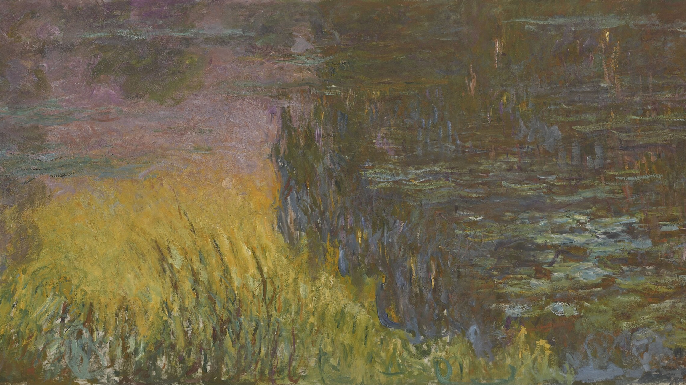

# Monet — an Omarchy theme

A soft, painterly dark theme — dusk over the lily pond at Giverny, with wisteria lilac, lily-pad green, water-lily rose and pale sunlight gold — from Claude Monet's Impressionist light.



## Install

```bash
omarchy theme install https://github.com/Van-Ausburn/omarchy-monet-theme
omarchy theme set monet
```

Cycle through the paintings with `omarchy theme bg next`.

## Palette

A gentle blue-green dusk background (never pure black), misty text, and pastel ANSI colors from *Water Lilies* and *Impression, Sunrise*.

| Role | Color |
|---|---|
| `accent` | `#b9a3e3` |
| `selection` | `#3d4a63` |
| `muted` | `#5b6577` |
| `background` | `#222b35` |
| `dark_background` | `#1b232c` |
| `darker_background` | `#141b22` |
| `lighter_background` | `#2f3a47` |
| `foreground` | `#ece6f0` |
| `dark_foreground` | `#8a93a6` |
| `light_foreground` | `#d6d0e0` |
| `bright_foreground` | `#f7f3fa` |
| `red` | `#e88f9a` |
| `yellow` | `#ecd27a` |
| `orange` | `#f0a878` |
| `green` | `#8fc49a` |
| `cyan` | `#8cc8d0` |
| `blue` | `#87a8e0` |
| `magenta` | `#c9a0dc` |
| `brown` | `#b08a68` |
| `bright_red` | `#f4adb5` |
| `bright_yellow` | `#f5e3a3` |
| `bright_green` | `#addbb6` |
| `bright_cyan` | `#acdde3` |
| `bright_blue` | `#a9c2ee` |
| `bright_magenta` | `#dcbde9` |

## Boot & login screen

The theme ships an `unlock.png` logo in its accent color. To use it for the Plymouth boot screen and SDDM login:

```bash
omarchy plymouth set by theme monet
```


## Wallpapers

All paintings are in the **public domain** and were sourced from Wikimedia Commons. Each is cropped to fill a 16:9 screen:

- [Water Lilies, Setting Sun](https://commons.wikimedia.org/wiki/File:Claude_Monet_-_The_Water_Lilies_-_Setting_Sun_-_Google_Art_Project.jpg) — Claude Monet, c. 1907
- [Impression, Sunrise](https://commons.wikimedia.org/wiki/File:Monet_-_Impression,_Sunrise.jpg) — Claude Monet, 1872
- [Water Lilies](https://commons.wikimedia.org/wiki/File:Claude_Monet_-_Water_Lilies_-_Google_Art_Project_(431238).jpg) — Claude Monet, c. 1915–26
- [Poppy Field](https://commons.wikimedia.org/wiki/File:Claude_Monet_-_Poppy_Field_-_Google_Art_Project.jpg) — Claude Monet, 1873
- [The Houses of Parliament, Sunset](https://commons.wikimedia.org/wiki/File:Claude_Monet_-_The_Houses_of_Parliament,_Sunset.jpg) — Claude Monet, 1903

## License

Theme files (palette, icon choice, previews) are MIT licensed — see [LICENSE](LICENSE).
The paintings are public domain.

The boot-screen logo (`unlock.png`) is a recolored copy of the [Omarchy](https://github.com/basecamp/omarchy) wordmark, Copyright (c) David Heinemeier Hansson, used under the MIT License — see [LICENSE-omarchy](LICENSE-omarchy).
